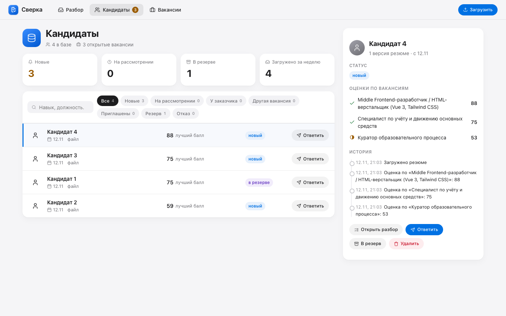
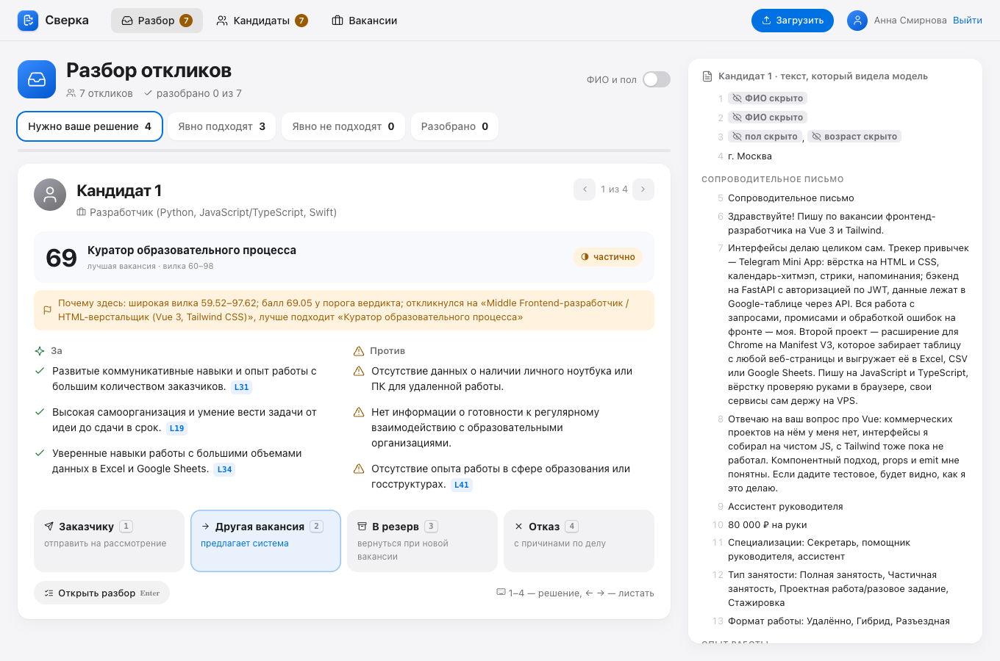

# Сверка — резюме и вакансии

Сервис для рекрутера: загружаете резюме (одно, пачку или zip) — получаете по каждой открытой
вакансии таблицу требований со статусами «есть / частично / нет / не указано» и цитатой из резюме,
балл с вилкой, рейтинг вакансий, переадресацию на более подходящую вакансию, вопросы кандидату и
пакет для нанимающего руководителя.

Для кого: рекрутер МФТИ, который разбирает до сотен откликов в день без ATS, и руководитель,
которому нужен короткий сравнительный документ по кандидатам.

Резюме попадают в сервис четырьмя путями: ручная загрузка, почтовый ящик (IMAP), отклики
работодателя на hh.ru и общая папка; последние три сервис опрашивает сам («Входящие»).
Руководитель рекрутинга видит в «Сводке» поток откликов по дням и источникам, очередь и
просроченные отклики, передачу заказчикам и воронку по каждой вакансии.

Главный принцип: **модель читает, код решает.** Языковая модель только извлекает требования и
находит строки резюме; статусы, стаж, балл, рейтинг и проверку цитат считает код.



## Быстрый старт

Нужен Docker с Compose **2.24 или новее** (Docker Desktop или Docker Engine 24+; более старый
Compose не понимает необязательный `env_file` с `required: false`), 2 ГБ памяти, 2 ГБ диска.

```bash
docker compose up -d --build
```

Откройте <http://127.0.0.1:8000>, нажмите «Рекрутер» в блоке демо-доступа. Без `.env` сервис
стартует в демо-режиме:

- вход по роли без пароля (`RVM_DEMO_LOGIN=1`);
- при первом старте в пустую базу загружаются три вакансии кейса и три синтетических резюме
  из `data/demo/` (`RVM_SEED=1`) — отклики на первую вакансию;
- ключа модели нет — ответы модели берутся только из кэша `data/demo/cache.sqlite`: в нём живые
  ответы `qwen/qwen3.6-35b-a3b` по вакансиям и резюме кейса и по демо-резюме; новые файлы без
  ключа разбирает демо-модель без ИИ — только для показа;
- соль обезличивания и ключ сессий генерируются один раз и хранятся в томе (`var/keys.env`),
  в журнале — предупреждение.

Остановка и удаление:

```bash
docker compose down        # остановить, база остаётся в томе rvm-var
docker compose down -v     # остановить и удалить базу, кэш и ключи
docker compose logs -f app # журнал
```

С настоящей моделью: `cp .env.example .env`, заполните `LLM_*` и перезапустите
`docker compose up -d`. Стенд для показа — задайте свои `RVM_SECRET`, `RVM_HASH_SALT`,
хэши паролей и `RVM_DEMO_LOGIN=0`.

Без Docker (разработка): Python 3.12, [uv](https://docs.astral.sh/uv/), для сканов —
`tesseract` с языками `rus` и `eng`, для `.doc` — `antiword`.

```bash
uv sync
RVM_HASH_SALT=$(openssl rand -hex 32) RVM_DEMO_LOGIN=1 uv run rvm serve
uv run pytest -q
```

## Переменные окружения

Все необязательны; образец — `.env.example`. В compose `.env` подхватывается, если он есть.

| Переменная | По умолчанию | Назначение |
|---|---|---|
| `LLM_BASE_URL` | — | OpenAI-совместимый endpoint (OpenRouter, Yandex, Cloud.ru, Ollama, vLLM) |
| `LLM_API_KEY` | — | ключ провайдера; пусто — демо-режим (только кэш) |
| `LLM_MODEL` | — | идентификатор модели у провайдера |
| `LLM_MODE` | `live` | `demo` — никогда не вызывать модель: ответы из кэша, новые файлы разбирает демо-модель без ИИ; ключ и `LLM_MODEL` не нужны |
| `LLM_MAX_TOKENS` | `4096` | лимит длины ответа модели; обрезанный ответ — ошибка с подсказкой |
| `LLM_PROVIDER_SORT` | `throughput` | только OpenRouter: как выбирать хостера модели (`throughput`, `price`, `latency`); пусто — порядок OpenRouter |
| `LLM_REASONING_EFFORT` | `low` для gpt-oss | только OpenRouter: уровень рассуждений модели; без него у остальных моделей рассуждения выключены |
| `RVM_WORKERS` | `4` | сколько пар резюме × вакансия разбирать параллельно |
| `RVM_DEMO_LOGIN` | `1` в compose | `1` — кнопки «войти как рекрутер / руководитель» без пароля |
| `RVM_PASSWORD_ANNA`, `RVM_PASSWORD_OLEG` | — | хэши паролей учёток (scrypt), без них вход по паролю закрыт; хэш: `uv run python -c "from rvm.api.auth import hash_password; print(hash_password('пароль'))"` или то же через `docker compose run --rm app python -c ...` |
| `RVM_HASH_SALT` | генерируется | ключ HMAC для поиска повторов по телефону и почте (не короче 16 символов); смена ключа — старые карточки перестанут находиться как повторы |
| `RVM_SECRET` | генерируется | ключ подписи cookie сессий |
| `RVM_ALLOWED_HOSTS` | — | домены стенда через запятую (`localhost` и `127.0.0.1` разрешены всегда) |
| `RVM_SEED` | `1` в compose | загрузить демо-данные в пустую базу при старте |
| `RVM_DEMO_DIR` | `data/demo` | откуда брать демо-данные |
| `RVM_DB` | `var/rvm.sqlite` | база SQLite |
| `RVM_CACHE` | `var/cache.sqlite` | кэш ответов модели |
| `RVM_CACHE_TTL_DAYS` | `30` | срок хранения кэша (в нём ответы по обезличенным резюме) |
| `RVM_TZ` | `Europe/Moscow` | часовой пояс календарных дней «Сводки» («сегодня», возраст в очереди) |
| `RVM_SLA_DAYS` | `2` | срок разбора: в «Сводке» отдельно считаются отклики, которые ждут дольше |
| `RVM_POLL_MINUTES` | `5` | опрос «Входящих» раз в N минут; `0` — только кнопка «Проверить сейчас»; меньше 1 — раз в минуту; не число — 5 |
| `RVM_IMAP_HOST`, `RVM_IMAP_USER`, `RVM_IMAP_PASSWORD` | — | почтовый ящик откликов; без всех трёх источник «Почта» не подключён; пароль только в окружении, в базу и журнал не пишется |
| `RVM_IMAP_PORT` | `993` / `143` | порт IMAP; по умолчанию зависит от `RVM_IMAP_SSL` |
| `RVM_IMAP_SSL` | `1` | `1` — IMAP по SSL, `0` — без SSL |
| `RVM_IMAP_FOLDER` | `INBOX` | папка ящика |
| `RVM_HH_TOKEN` | — | OAuth-токен менеджера работодателя на hh.ru для источника «hh.ru» (только чтение откликов) |
| `RVM_INBOX_DIR` | — | общая папка для источника «Папка»; разобранные файлы переносятся в `done/` и `error/` внутри неё |
| `RVM_DEMO_MAIL_PASSWORD` | `demo` | пароль ящика `hr@rvm.local` демо-почты (compose, профиль `mail`) |
| `RVM_DEMO_MAIL_TO`, `RVM_SMTP_HOST`, `RVM_SMTP_PORT` | `hr@rvm.local`, `mail`, `3025` | куда `scripts/send_demo_mail.py` отправляет демо-отклик |
| `RVM_TODAY` | сегодня | зафиксировать дату для расчёта стажа (воспроизводимые прогоны) |
| `RVM_HH_EMPLOYER` | `1008541` | работодатель на hh.ru для импорта вакансий (МФТИ) |
| `RVM_HH_USER_AGENT` | `rvm/0.1` | User-Agent для api.hh.ru в формате `Название/версия (почта)`; без контакта hh отвечает 403 и импорт вакансий выключается с ошибкой 502 |
| `RVM_DATA_DIR` | — | папка с файлами кейса для тестов и замера качества |
| `RVM_ENV_FILE`, `RVM_EVAL_PARALLEL` | `.env`, `4` | только `eval/run_eval.py`: файл с ключами модели и число резюме, разбираемых параллельно |

## Внешние сервисы

Все необязательны, сервис поднимается без сети.

- **OpenAI-совместимый провайдер модели** — разбор новых файлов. Уходит только обезличенный
  текст (см. «Архитектура»). Для OpenRouter запрос идёт с запретом хранения данных у провайдера.
- **Закрытый контур** — модель локально в Ollama, данные не покидают машину:
  `docker compose --profile local up -d`, в `.env`: `LLM_BASE_URL=http://ollama:11434/v1`,
  `LLM_API_KEY=ollama`, `LLM_MODEL=<модель>`; модель скачать
  `docker compose exec ollama ollama pull <модель>`.
- **api.hh.ru** (публичный, без ключа) — список открытых вакансий МФТИ и импорт выбранных.
- **api.hh.ru, API работодателя** (`RVM_HH_TOKEN`) — отклики на импортированные с hh вакансии и
  файлы резюме. Сервис только читает: статус отклика на hh не меняется.
- **Почтовый ящик по IMAP** (`RVM_IMAP_*`) — письма с резюме во вложениях. Сервис только читает
  письма и ставит им отметку «прочитано».
- **Демо-почта** (GreenMail, профиль `mail`) — локальный ящик для показа «Входящих» на стенде,
  порты наружу не публикуются.

Что уходит наружу: провайдеру модели — только обезличенный текст; в hh и в почтовый ящик —
только запросы на чтение откликов и писем (плюс отметка «прочитано» в почте), данные кандидатов
туда не отправляются. Пароль ящика и токен hh хранятся только в окружении и вычищаются из статуса источника и журнала.

## Входящие

Источники, которые сервис опрашивает сам: раз в `RVM_POLL_MINUTES` минут и по кнопке «Проверить
сейчас» в окне «Загрузить» → вкладка «Входящие». Там же по каждому источнику: подключён или каких
переменных не хватает, когда проверяли, сколько забрали и пропустили за сегодня, ошибка и последние
20 поступлений со ссылкой на карточку. Забранный файл идёт в тот же конвейер, что ручная загрузка
(распаковка zip, лимиты, обезличивание, оценка); у кандидата сохраняется источник: `файл`,
`почта`, `hh` или `папка`.

| Источник | Как подключить | Вакансия отклика |
|---|---|---|
| Почта | `RVM_IMAP_HOST`, `RVM_IMAP_USER`, `RVM_IMAP_PASSWORD`; при необходимости `RVM_IMAP_PORT`, `RVM_IMAP_SSL`, `RVM_IMAP_FOLDER` | тема письма содержит название открытой вакансии (без учёта регистра); подходят несколько — берётся самое длинное название |
| hh.ru | `RVM_HH_TOKEN` и `RVM_HH_USER_AGENT`; вакансии импортированы с hh («Актуальные вакансии МФТИ» при добавлении вакансии) | вакансия, на которую откликнулись на hh |
| Папка | `RVM_INBOX_DIR` — общая папка (выгрузка с hh, правило почтового клиента, сканер) | имя файла с префиксом `<id вакансии>__`, например `3__Иванов.docx`; резюме сохранится как `Иванов.docx` |

Нет совпадения или вакансия закрыта — кандидат попадает в базу без вакансии отклика; оценка всё
равно идёт по всем открытым вакансиям.

Как работает каждый источник:

- **Почта** — письма за последние 14 дней с вложениями резюме (docx, doc, pdf, rtf, odt, html,
  txt, сканы) и zip; вложения одного письма — одна пачка. Письмо читается без отметки
  «прочитано», отметка ставится после постановки в очередь — как подсказка человеку в почтовом
  клиенте. Письмо без подходящих вложений учитывается один раз как пропущенное.
- **hh.ru** — для каждой открытой вакансии, импортированной с hh, коллекция «Все неразобранные»
  откликов; резюме скачивается в PDF (нет — RTF) только по https с hh.ru и его поддоменов. Ответы
  401, 403, 429 прерывают опрос до следующего раза, причина видна в статусе источника.
  **Проверено только на имитации API** по документации hh: живого доступа работодателя у нас
  нет. Для работы нужен токен менеджера работодателя МФТИ: приложение на
  [dev.hh.ru](https://dev.hh.ru), вход менеджером, получение токена по
  [authorization code](https://github.com/hhru/api/blob/master/docs/authorization_for_user.md).
- **Папка** — обычные файлы верхнего уровня; скрытые, временные (`~$…`, `….part`), подпапки и
  символические ссылки пропускаются. Файл, изменённый меньше 10 секунд назад, ждёт следующего
  опроса. После разбора файл переносится в `done/` или `error/` внутри папки.

Повторы: каждый забранный элемент запоминается (почта — по Message-ID, hh — по id отклика,
папка — по имени, размеру и времени изменения) и второй раз не забирается. Тот же файл из
разных источников не создаёт второго кандидата, общий телефон или почта — пометка «повтор», как
при ручной загрузке.

Лимиты за один опрос источника: не больше 100 элементов и 200 МБ, остальное — в следующий опрос;
файл больше 15 МБ и письмо больше 200 МБ пропускаются с причиной. Сбой источника не останавливает
сервис: ошибка видна в статусе и пишется в журнал.

### Демо-почта на стенде

Ящик `hr@rvm.local` на GreenMail внутри сети compose, `app` получает настройки `RVM_IMAP_*` из
`docker-compose.mail.yml`:

```bash
docker compose -f docker-compose.yml -f docker-compose.mail.yml --profile mail up -d
docker compose exec app python scripts/send_demo_mail.py "data/demo/Резюме А.txt" \
    --vacancy "<название открытой вакансии>"
```

Название вакансии в теме письма — как в разделе «Вакансии». Письмо заберётся при следующем опросе
или сразу по «Проверить сейчас».

## Сводка

Экран «Сводка» (роль рекрутер; в боевом запуске — руководитель рекрутинга), период: сегодня,
7 или 30 дней. Только чтение базы и журнала расхода модели, без вызовов модели.

- поток откликов по дням и по источникам;
- очередь: сколько не разобрано, возраст самого старого, сколько ждут дольше `RVM_SLA_DAYS`;
- передано заказчикам и сколько ждут ответа заказчика;
- воронка по вакансиям: откликов → разобрано → передано заказчику → решение заказчика, отказ,
  резерв и переадресация, медианы времени до решения;
- «не потеряли» (ушли в резерв или на другую вакансию вместо отказа), согласие рекрутера на
  выборочной проверке, расход модели.

Календарные дни считаются в поясе `RVM_TZ`. Определения каждой цифры — в
`src/rvm/store/metrics.py`.

## Архитектура и поток данных

```
Браузер (одна страница, без сборки)
   │ REST, cookie-сессия
FastAPI (src/rvm/api)
 ├─ sources    «Входящие»: почта (IMAP), отклики hh, папка → фоновый опрос → тот же конвейер,
 │             что ручная загрузка; уже забранное — в таблице source_seen
 ├─ ingest     сигнатура файла → docx | doc | pdf | rtf | odt | html | txt; нет текста → OCR
 │             (pypdfium2 → Tesseract rus+eng) → нумерованные строки [L1..Ln]
 ├─ privacy    ФИО, телефоны, почты, ссылки, адреса, дата рождения, возраст, пол → маски
 │             (regex + Natasha); телефон и почта → HMAC для пометки повторов; повторная проверка — нашли ПДн, наружу не отправляем
 ├─ extract*   вакансия → требования (обязательные, желательные, условия) + справочник навыков;
 │             резюме → места работы, периоды, образование, город, формат
 ├─ facts      стаж кодом (слияние интервалов), сверка с заявленным, несостыковки
 ├─ match*     одна пара «резюме × вакансия» → статус + номер строки + цитата
 ├─ verify     цитата есть в тексте? (точно, затем rapidfuzz ≥ 90) нет → «не указано» + флаг
 ├─ scoring    балл, вилка, блокеры, вердикт, рейтинг вакансий, переадресация
 ├─ explain*   по готовой таблице → «Кратко», риски, вопросы кандидату, письма
 ├─ guard      юридический фильтр вопросов; в тексте нет навыков и чисел, которых нет в таблице
 └─ dashboard  «Сводка»: поток, очередь, воронка — только чтение базы и журнала расхода модели
SQLite: кандидаты, версии резюме, оценки, решения и журнал; кэш ответов модели
* — вызов модели через один OpenAI-совместимый клиент (кэш, строгая JSON-схема, temperature 0)
```

Правила, которые проверяет код, а не модель:

- «нет» — только с цитатой-противоречием; молчание резюме — «не указано» и вопрос кандидату;
- балл = Σ(вес × значение) / Σ(вес) × 100, веса: обязательное 3, желательное 1, условия 0;
  «не указано» даёт вилку от 0 до 1;
- вакансии без блокеров (обязательное «нет») выше вакансий с блокерами, внутри — по баллу;
  вердикт: ≥ 70 подходит, 45–70 частично, < 45 не подходит;
- возраст, пол, ФИО, гражданство в оценку и тексты не попадают.

## API

Полная схема — <http://127.0.0.1:8000/docs> (OpenAPI). Все маршруты, кроме `/api/health` и
входа, требуют сессию; изменяющие запросы — заголовок `X-Requested-With`.

| Маршрут | Что делает |
|---|---|
| `GET /api/health` | режим (`live` / `demo`), модель, версия |
| `POST /api/login` | вход: `{"login", "password"}` или демо `{"role": "recruiter"}` |
| `POST /api/uploads?applied=<id>` | загрузка резюме (файлы или zip), отклик на вакансию |
| `GET /api/uploads/{batch_id}` | прогресс пачки по файлам |
| `GET/POST /api/vacancies` | список и добавление вакансии (файл или текст); в списке — счётчики: откликов, не разобрано, подходит, у заказчика |
| `GET /api/vacancies/hh`, `POST /api/vacancies/hh/import` | вакансии МФТИ с hh.ru |
| `GET /api/candidates`, `GET /api/candidates/{id}` | база кандидатов и карточка |
| `GET /api/candidates?page=1&limit=50&offset=0` | список страницей `{items, total, limit, offset}` (limit до 200); фильтры `status`, `vacancy`, `verdict=fit,partial`, `source`, `days`, `q`, `sort=score\|date`; без `page` — весь список массивом, как раньше |
| `DELETE /api/candidates/{id}` | удалить кандидата со всеми данными: `204` — удалено; `200` с `{"ok": true, "warning": …}` — удалено, но журнал SQLite не обрезан (база занята), стёртое уйдёт из файла при следующей очистке |
| `POST /api/candidates/{id}/merge`, `POST /api/candidates/{id}/dismiss-duplicate` | повтор: объединить карточки или отметить «разные люди» |
| `PATCH /api/evaluations/{resume_id}/{vacancy_id}/rows/{req}` | ответ кандидата или правка строки → пересчёт балла и мест |
| `GET /api/evaluations/{resume_id}/{vacancy_id}` | отчёт по паре: таблица, цитаты, балл, вопросы |
| `GET /api/triage`, `POST /api/triage/decide` | «Разбор откликов»: корзины и решения; `?limit=N` — не больше N карточек в каждой корзине, сколько всего — в `totals` |
| `GET /api/sources` | «Входящие»: состояние почты, hh и папки, последние 20 поступлений |
| `POST /api/sources/{name}/check` | проверить источник сейчас (`mail`, `hh`, `folder`): `202` — опрос идёт в фоне, `409` — источник не настроен |
| `GET /api/dashboard?days=1\|7\|30` | «Сводка» за период |
| `GET /api/package` | пакет для заказчика (DOCX или HTML для печати) |

## Примеры работы

Шесть сценариев с цифрами, таблицами и снимками — [docs/use-cases.md](docs/use-cases.md). Ниже два
главных. Все цифры — ответы `qwen/qwen3.6-35b-a3b` по данным кейса (3 вакансии, 4 резюме кейса и
3 синтетических), записанные в `data/demo/cache.sqlite`; статусы, балл и рейтинг считает код.
Кандидаты подписаны номерами, ФИО в документации не показываем.

Эффект для рекрутера: по ответам заказчика ручное сопоставление резюме с вакансиями занимает
10–20 минут на кандидата и оформление — ещё 10–15; сервис готовит разбор по трём вакансиям
примерно за 37 секунд на резюме, рекрутеру остаётся проверить его и принять решение.

### 1. Резюме → рейтинг вакансий и переадресация

**Вход:** резюме 1 кейса (разработчик Python / JS с опытом аналитики) — отклик на «Middle
Frontend-разработчик». Загрузка через раздел «Загрузка» или API:

```bash
curl -c jar -H 'X-Requested-With: x' -H 'Content-Type: application/json' \
     -d '{"role":"recruiter"}' http://127.0.0.1:8000/api/login
curl -b jar -H 'X-Requested-With: x' -F 'files=@<резюме>.docx' \
     'http://127.0.0.1:8000/api/uploads?applied=1'
```

**Выход** (карточка кандидата → «Открыть разбор»):

| Место | Вакансия | Балл | Вилка | Вердикт |
|---|---|---|---|---|
| 1 | Куратор образовательного процесса | 69,05 | 59,52–97,62 | частично |
| 2 | Специалист по учёту и движению основных средств | 35,71 | 21,43–78,57 | не подходит |
| 3 | Middle Frontend-разработчик (отклик) | 45,16 | 40,32–59,68 | частично, 2 блокера |

- переадресация: «Лучше подходит «Куратор образовательного процесса»: 69 против 45 у вакансии
  отклика»; у Frontend два обязательных требования «нет» с цитатой из сопроводительного письма
  (L8 «с Tailwind тоже пока не работал», «коммерческих проектов на нём у меня нет») — поэтому
  вакансия ниже Учёта ОС, несмотря на больший балл;
- по каждой строке вакансии — статус и цитата с номером строки; цитаты, которых нет в тексте,
  код снимает в «не указано» с пометкой;
- «не указано» по обязательным (личный ноутбук, работа с образовательными организациями) →
  вопросы кандидату; после ответов «есть» балл по Куратору пересчитывается в 90,48 и вердикт —
  в «подходит».


### 2. Пачка откликов → «Разбор» → пакет для заказчика

**Вход:** семь резюме одной пачкой (файлы или zip) как отклики на «Middle Frontend-разработчик».

**Выход:**

1. «Загрузка» показывает прогресс по файлам: чтение → база → оценка. Тот же файл повторно не
   создаёт кандидата; общий телефон или почта с другой карточкой (сравниваются HMAC-хэши) —
   пометка «повтор», объединяет карточки только рекрутер («Объединить» / «Разные люди»).
2. «Разбор откликов» раскладывает пачку: «Нужно ваше решение» — 4 (переадресация на другую
   вакансию, широкая вилка, балл у порога), «Явно подходят» — 3 (88,71; 81,45; 79,03), «Явно не
   подходят» — 0. Решение одной клавишей: 1 — заказчику, 2 — другая вакансия, 3 — резерв,
   4 — отказ. Автоотказа нет: из «явно не подходят» каждый десятый идёт на выборочную проверку.
3. Двое лучших «заказчику» → «Пакет для заказчика»: один DOCX (или PDF) со сравнительной таблицей
   по обязательным требованиям, «Кратко», риски и вопросы на собеседование по каждому; ФИО — по
   решению рекрутера, по умолчанию «Кандидат №7».
4. Нанимающий руководитель входит своей учёткой, видит только кандидатов «у заказчика» без ФИО и
   отвечает «Пригласить на интервью» / «Не подходит».



## Качество

Замер на эталонной разметке кейса — `eval/`: `eval/gold/case.yaml` (статусы требований вручную,
это наша разметка, не организаторов), `eval/run_eval.py` (прогон конвейера и метрики). Последний
прогон — `eval/report.md` и `eval/last.json`, модель `qwen/qwen3.6-35b-a3b`, 4 резюме × 3 вакансии:

| Метрика | Значение |
|---|---|
| Точность статусов требований, строго | 72 % (116 пар) |
| То же с допустимыми альтернативами | 91 % |
| «Нет»: точность / полнота | 100 % / 29 % — модель осторожна, «нет» ставит только с цитатой |
| Проверенных цитат | 97 % |
| Первое место в рейтинге совпало | 4 из 4 |
| Порядок вакансий совпал целиком | 3 из 4 |
| Переадресация верна | 4 из 4 |
| Полнота извлечения требований | 81 % (29 из 36) |

Запуск: `uv run python eval/run_eval.py --data <папка с файлами кейса>`.

## Выбор модели и экономика

Модель выбирали сравнением на одном эталоне (4 резюме × 3 вакансии, OpenRouter, temperature 0):

| Модель | Статусы строго | С альтернативами | Первое место | Время |
|---|---|---|---|---|
| **qwen/qwen3.6-35b-a3b** (выбрана) | 72 % | 91 % | 4/4 | ≈ 37 с на резюме, прогон 77 с |
| qwen/qwen3-235b-a22b-2507 | 73 % | 91 % | 4/4 | прогон 691 с (≈ 11 мин) |
| openai/gpt-oss-120b | 64–65 % | 88–89 % | 4/4 | прогон 10–13 с |
| openai/gpt-oss-20b | — | — | 1/4 | извлекает 47 % требований, не годится |

Почему qwen3.6-35b-a3b: на одних промптах качество как у модели почти в 7 раз больше
(73 % / 91 % у обеих), а прогон в 6 раз быстрее;
gpt-oss-120b быстрее, но на 7–8 п. п. хуже по статусам. И главное — открытые веса под Apache-2.0,
то есть ту же модель можно поднять в контуре МФТИ.

**Стоимость через OpenRouter.** Цена модели — $0,10 за 1 млн входных и $0,90 за 1 млн выходных
токенов (`https://openrouter.ai/api/v1/models`, 13.11.2026). Замер: 46 вызовов, 77 293 входных
и 35 530 выходных токенов на 4 резюме × 3 вакансии (с разбором самих вакансий) — около $0,04 за
прогон, то есть ≈ 19 тыс. входных и 9 тыс. выходных токенов, **≈ $0,01 на резюме** при трёх
открытых вакансиях. Пиковый день в 300 откликов — **≈ $3**. Стоимость растёт линейно с числом
открытых вакансий: сопоставление и пояснение считаются на каждую пару «резюме × вакансия»;
повторный разбор того же текста берётся из кэша бесплатно.

**Закрытый контур МФТИ.** Qwen3.6-35B-A3B — MoE на 35 млрд параметров, из них 3 млрд активных на
токен, лицензия Apache-2.0 ([карточка модели](https://huggingface.co/Qwen/Qwen3.6-35B-A3B)).
Сервис говорит с моделью по OpenAI-совместимому API, поэтому достаточно поменять `LLM_BASE_URL`:

- Ollama — `docker compose --profile local up -d`, модель `qwen3.6:35b`, квантованные веса 23 ГБ
  ([библиотека Ollama](https://ollama.com/library/qwen3.6)); вместе с контекстом нужна видеокарта
  от 32 ГБ или две по 24 ГБ, либо машина с общей памятью от 32 ГБ;
- vLLM или SGLang (указаны в карточке модели) — веса BF16 ≈ 72 ГБ (36 млрд параметров × 2 байта),
  то есть одна GPU на 80 ГБ или несколько меньших с тензорным параллелизмом.

Скорость локального запуска мы не замеряли; благодаря 3 млрд активных параметров модель
нетребовательна к вычислениям, ограничение — память под веса. Данные при этом не покидают
машину, обезличивание остаётся включённым.

## Нагрузка

Время ответа API на синтетических базах из `eval/load.md`. Машина: Apple M5 Pro, 15 ядер,
Python 3.12.14, SQLite 3.54.1. Базы — `eval/load_seed.py` (копии разборов демо-данных,
`random.Random(42)`), запросы последовательные в одном процессе, 3 прогревочных и 30 замеров на
маршрут, вход рекрутером. Сеть и модель в замер не входят.

| Запрос | 5 000: p50 / p95, мс | 20 000: p50 / p95, мс | Ответ, КБ (5 000 / 20 000) |
|---|---:|---:|---:|
| список, страница `/api/candidates?page=1` | 25 / 28 | 90 / 106 | 20 / 20 |
| список, вакансия + вердикт `/api/candidates?page=1&vacancy=1&verdict=fit,partial` | 39 / 51 | 158 / 296 | 20 / 20 |
| список, поиск `/api/candidates?page=1&q=figma` | 98 / 117 | 396 / 410 | 20 / 20 |
| список целиком (старый) `/api/candidates` | 149 / 162 | 608 / 842 | 1993 / 7985 |
| вакансии со счётчиками `/api/vacancies` | 33 / 51 | 128 / 182 | 1 / 1 |
| разбор потока целиком `/api/triage` | 726 / 923 | 3008 / 4484 | 3281 / 13125 |
| разбор потока, по 50 в корзине `/api/triage?limit=50` | 164 / 173 | 640 / 695 | 148 / 148 |
| счётчики шапки `/api/stats` | 9 / 10 | 46 / 49 | 0 / 0 |

Размер базы: 255 МБ на 5 000 кандидатов, 1022 МБ на 20 000.

Предел:

- на 5 000 кандидатов страница списка с фильтрами и поиском, счётчики вакансий и «Разбор» с
  `limit` отвечают быстрее 300 мс;
- на 20 000 медленнее 300 мс поиск по тексту `q` (≈ 400 мс: перебор текста каждого резюме) и
  «Разбор» даже с `limit=50` (≈ 650 мс: сводка по всем кандидатам);
- «Разбор» без `limit` и список без `page` отдают всё целиком: 726 мс и 3 МБ уже на 5 000.
  Экран «Разбор откликов» пока запрашивает именно так, перевод на `limit` — следующий шаг.

Повторить:

```bash
uv run python eval/load_seed.py --n 5000 --db <база>
uv run python eval/load_bench.py --db <база> --out eval/load.md
```

## Внедрение

План пилота в отделе кадров МФТИ — каналы откликов, этапы, что меряем, персональные данные и
152-ФЗ, риски: [docs/rollout.md](docs/rollout.md).

## Ограничения

- Без ключа модели (или при `LLM_MODE=demo`) живого разбора нет: ответы из кэша, новые файлы
  разбирает демо-модель без ИИ — только для показа.
- Качество разбора зависит от модели; статусы и балл всё равно считает код по проверенным цитатам.
- После ответов кандидата «Кратко» пересобирается по правилам, без модели: цифры и риски
  новые, формулировки суше, чем при разборе.
- Сканы плохого качества распознаются с предупреждением, цитаты по ним проверяются мягче.
- Нет полноценного управления пользователями: две учётки (рекрутер и руководитель) из окружения.
- Одна база SQLite: рассчитано на одного рекрутера и сотни откликов в день, не на кластер;
  замер времени ответа — в разделе «Нагрузка».
- Источник «hh.ru» проверен только на имитации API: нужен токен менеджера работодателя МФТИ.
  Статус отклика на hh сервис не меняет.
- Почта забирает письма за последние 14 дней: если сервис простоял дольше, старые письма
  нужно загрузить вручную.
- Ghostscript в образе намеренно отсутствует (сторонний интерпретатор PostScript не нужен).

## Структура репозитория

```
src/rvm/           пакет: api (сервер и интерфейс), sources («Входящие»), ingest, privacy,
                   pipeline, scoring, store, refs (справочники), llm (клиент модели), prompts
tests/             тесты (pytest, без сети: модель, IMAP и hh подменяются имитацией)
eval/              эталон, замер качества и отчёт последнего прогона; load_seed.py,
                   load_bench.py и load.md — замер нагрузки
data/demo/         демо-данные: вакансии кейса и синтетические резюме
scripts/start.py   запуск в контейнере: ключи, демо-данные, сервер
scripts/send_demo_mail.py  демо-отклик письмом в ящик демо-почты
docs/use-cases.md  сценарии работы с цифрами по данным кейса
docs/rollout.md    план внедрения
docs/screens/      скриншоты интерфейса
Dockerfile, docker-compose.yml, docker-compose.mail.yml (демо-почта)
```
