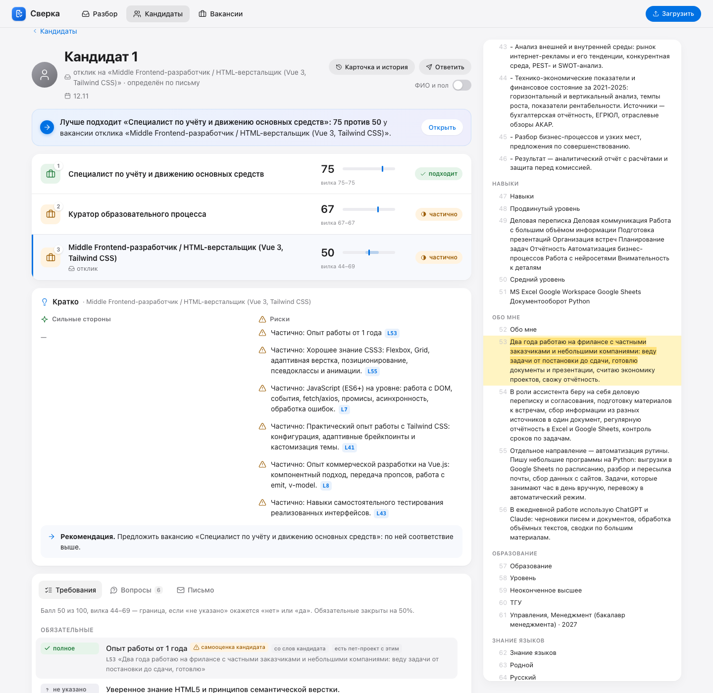
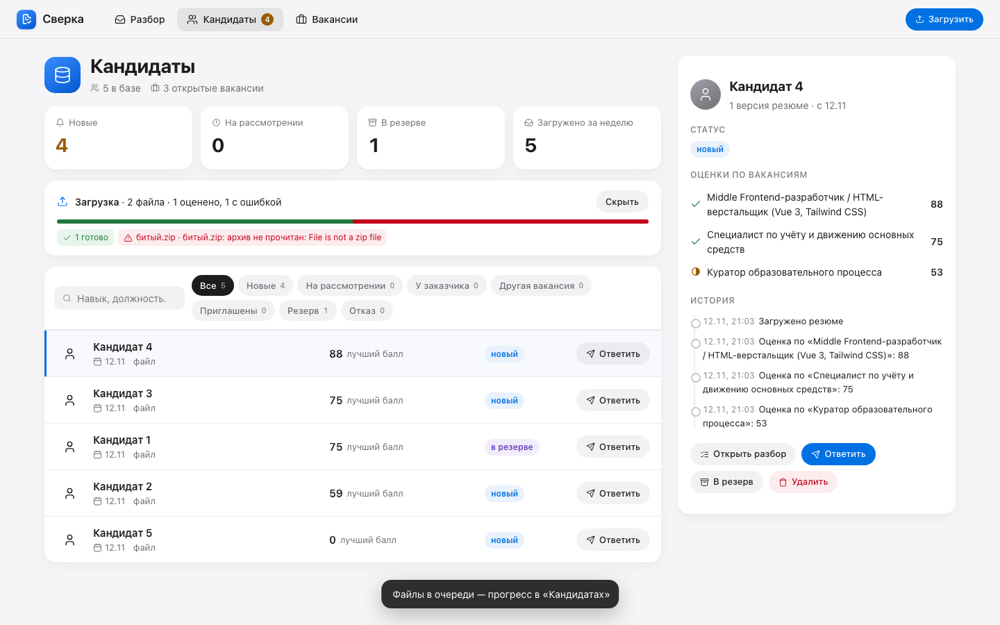

# Сверка — резюме и вакансии

Сервис для рекрутера: загружаете резюме (одно, пачку или zip) — получаете по каждой открытой
вакансии таблицу требований со статусами «есть / частично / нет / не указано» и цитатой из резюме,
балл с вилкой, рейтинг вакансий, переадресацию на более подходящую вакансию, вопросы кандидату и
пакет для нанимающего руководителя.

Для кого: рекрутер МФТИ, который разбирает до сотен откликов в день без ATS, и руководитель,
которому нужен короткий сравнительный документ по кандидатам.

Главный принцип: **модель читает, код решает.** Языковая модель только извлекает требования и
находит строки резюме; статусы, стаж, балл, рейтинг и проверку цитат считает код.


## Быстрый старт

Нужен Docker с Compose v2 (Docker Desktop или Docker Engine 24+), 2 ГБ памяти, 2 ГБ диска.

```bash
docker compose up -d --build
```

Откройте <http://127.0.0.1:8000>, нажмите «Рекрутер» в блоке демо-доступа. Без `.env` сервис
стартует в демо-режиме:

- вход по роли без пароля (`RVM_DEMO_LOGIN=1`);
- при первом старте в пустую базу загружаются три вакансии кейса и три синтетических резюме
  из `data/demo/` (`RVM_SEED=1`) — отклики на первую вакансию;
- ключа модели нет — ответы модели берутся только из кэша (`data/demo/cache.sqlite`, если он
  есть); новые файлы без ключа разобрать нельзя, демо-данные размечены встроенной демо-моделью;
- соль обезличивания и ключ сессий генерируются один раз и хранятся в томе (`var/keys.env`),
  в журнале — предупреждение.

Остановка и удаление:

```bash
docker compose down        # остановить, база остаётся в томе rvm-var
docker compose down -v     # остановить и удалить базу, кэш и ключи
docker compose logs -f app # журнал
```

С настоящей моделью: `cp .env.example .env`, заполните `LLM_*` и перезапустите
`docker compose up -d`. Стенд для показа — задайте свои `RVM_SECRET`, `RVM_HASH_SALT`,
хэши паролей и `RVM_DEMO_LOGIN=0`.

Без Docker (разработка): Python 3.12, [uv](https://docs.astral.sh/uv/), для сканов —
`tesseract` с языками `rus` и `eng`, для `.doc` — `antiword`.

```bash
uv sync
RVM_HASH_SALT=$(openssl rand -hex 32) RVM_DEMO_LOGIN=1 uv run rvm serve
uv run pytest -q
```

## Переменные окружения

Все необязательны; образец — `.env.example`. В compose `.env` подхватывается, если он есть.

| Переменная | По умолчанию | Назначение |
|---|---|---|
| `LLM_BASE_URL` | — | OpenAI-совместимый endpoint (OpenRouter, Yandex, Cloud.ru, Ollama, vLLM) |
| `LLM_API_KEY` | — | ключ провайдера; пусто — демо-режим (только кэш) |
| `LLM_MODEL` | — | идентификатор модели у провайдера |
| `LLM_MODE` | `live` | `demo` — никогда не вызывать модель, только кэш |
| `RVM_DEMO_LOGIN` | `1` в compose | `1` — кнопки «войти как рекрутер / руководитель» без пароля |
| `RVM_PASSWORD_ANNA`, `RVM_PASSWORD_OLEG` | — | хэши паролей учёток (scrypt), без них вход по паролю закрыт; хэш: `uv run python -c "from rvm.api.auth import hash_password; print(hash_password('пароль'))"` или то же через `docker compose run --rm app python -c ...` |
| `RVM_HASH_SALT` | генерируется | ключ HMAC для склейки дублей кандидатов по телефону и почте (не короче 16 символов); смена ключа — дубли перестанут склеиваться |
| `RVM_SECRET` | генерируется | ключ подписи cookie сессий |
| `RVM_ALLOWED_HOSTS` | — | домены стенда через запятую (`localhost` и `127.0.0.1` разрешены всегда) |
| `RVM_SEED` | `1` в compose | загрузить демо-данные в пустую базу при старте |
| `RVM_DEMO_DIR` | `data/demo` | откуда брать демо-данные |
| `RVM_DB` | `var/rvm.sqlite` | база SQLite |
| `RVM_CACHE` | `var/cache.sqlite` | кэш ответов модели |
| `RVM_CACHE_TTL_DAYS` | `30` | срок хранения кэша (в нём ответы по обезличенным резюме) |
| `RVM_TODAY` | сегодня | зафиксировать дату для расчёта стажа (воспроизводимые прогоны) |
| `RVM_HH_EMPLOYER` | `1008541` | работодатель на hh.ru для импорта вакансий (МФТИ) |
| `RVM_HH_USER_AGENT` | `rvm/0.1` | User-Agent для api.hh.ru |
| `RVM_DATA_DIR` | — | папка с файлами кейса для тестов и замера качества |

## Внешние сервисы

Все необязательны, сервис поднимается без сети.

- **OpenAI-совместимый провайдер модели** — разбор новых файлов. Уходит только обезличенный
  текст (см. «Архитектура»). Для OpenRouter запрос идёт с запретом хранения данных у провайдера.
- **Закрытый контур** — модель локально в Ollama, данные не покидают машину:
  `docker compose --profile local up -d`, в `.env`: `LLM_BASE_URL=http://ollama:11434/v1`,
  `LLM_API_KEY=ollama`, `LLM_MODEL=<модель>`; модель скачать
  `docker compose exec ollama ollama pull <модель>`.
- **api.hh.ru** (публичный, без ключа) — список открытых вакансий МФТИ и импорт выбранных.

## Архитектура и поток данных

```
Браузер (одна страница, без сборки)
   │ REST, cookie-сессия
FastAPI (src/rvm/api)
 ├─ ingest     сигнатура файла → docx | doc | pdf | rtf | odt | html | txt; нет текста → OCR
 │             (pypdfium2 → Tesseract rus+eng) → нумерованные строки [L1..Ln]
 ├─ privacy    ФИО, телефоны, почты, ссылки, адреса, дата рождения, возраст, пол → маски
 │             (regex + Natasha); телефон и почта → HMAC для склейки дублей; повторная проверка — нашли ПДн, наружу не отправляем
 ├─ extract*   вакансия → требования (обязательные, желательные, условия) + справочник навыков;
 │             резюме → места работы, периоды, образование, город, формат
 ├─ facts      стаж кодом (слияние интервалов), сверка с заявленным, несостыковки
 ├─ match*     одна пара «резюме × вакансия» → статус + номер строки + цитата
 ├─ verify     цитата есть в тексте? (точно, затем rapidfuzz ≥ 90) нет → «не указано» + флаг
 ├─ scoring    балл, вилка, блокеры, вердикт, рейтинг вакансий, переадресация
 ├─ explain*   по готовой таблице → «Кратко», риски, вопросы кандидату, письма
 └─ guard      юридический фильтр вопросов; в тексте нет навыков и чисел, которых нет в таблице
SQLite: кандидаты, версии резюме, оценки, решения и журнал; кэш ответов модели
* — вызов модели через один OpenAI-совместимый клиент (кэш, строгая JSON-схема, temperature 0)
```

Правила, которые проверяет код, а не модель:

- «нет» — только с цитатой-противоречием; молчание резюме — «не указано» и вопрос кандидату;
- балл = Σ(вес × значение) / Σ(вес) × 100, веса: обязательное 3, желательное 1, условия 0;
  «не указано» даёт вилку от 0 до 1;
- вакансии без блокеров (обязательное «нет») выше вакансий с блокерами, внутри — по баллу;
  вердикт: ≥ 70 подходит, 45–70 частично, < 45 не подходит;
- возраст, пол, ФИО, гражданство в оценку и тексты не попадают.

## API

Полная схема — <http://127.0.0.1:8000/docs> (OpenAPI). Все маршруты, кроме `/api/health` и
входа, требуют сессию; изменяющие запросы — заголовок `X-Requested-With`.

| Маршрут | Что делает |
|---|---|
| `GET /api/health` | режим (`live` / `demo`), модель, версия |
| `POST /api/login` | вход: `{"login", "password"}` или демо `{"role": "recruiter"}` |
| `POST /api/uploads?applied=<id>` | загрузка резюме (файлы или zip), отклик на вакансию |
| `GET /api/uploads/{batch_id}` | прогресс пачки по файлам |
| `GET/POST /api/vacancies` | список и добавление вакансии (файл или текст) |
| `GET /api/vacancies/hh`, `POST /api/vacancies/hh/import` | вакансии МФТИ с hh.ru |
| `GET /api/candidates`, `GET /api/candidates/{id}` | база кандидатов и карточка |
| `GET /api/evaluations/{resume_id}/{vacancy_id}` | отчёт по паре: таблица, цитаты, балл, вопросы |
| `GET /api/triage`, `POST /api/triage/decide` | «Разбор откликов»: корзины и решения |
| `GET /api/package` | пакет для заказчика (DOCX или HTML для печати) |

## Примеры работы

Цифры ниже — по демо-данным и встроенной демо-модели; после прогона с настоящей моделью
заменяются. <!-- заменить -->

### 1. Резюме → рейтинг вакансий и переадресация

**Вход:** «Резюме Б.txt» из `data/demo/` (координатор образовательных программ) — отклик на
вакансию «Middle Frontend-разработчик».

```bash
curl -c jar -H 'X-Requested-With: x' -H 'Content-Type: application/json' \
     -d '{"role":"recruiter"}' http://127.0.0.1:8000/api/login
curl -b jar -H 'X-Requested-With: x' -F 'files=@data/demo/Резюме Б.txt' \
     'http://127.0.0.1:8000/api/uploads?applied=1'
```

**Ожидаемый выход** (карточка кандидата → «Открыть разбор»): <!-- заменить -->

| Место | Вакансия | Балл | Вилка | Вердикт |
|---|---|---|---|---|
| 1 | Куратор образовательного процесса | высокий | узкая | подходит |
| 2 | Специалист по учёту основных средств | низкий | — | не подходит |
| 3 | Middle Frontend-разработчик (отклик) | низкий | — | не подходит |

- переадресация: «откликнулся на Frontend-разработчика, лучше подходит Куратор» с разницей
  баллов и строками, которые её дали;
- по каждой строке вакансии — статус и цитата из резюме с номером строки;
- «не указано» по обязательным требованиям → вопросы кандидату.



### 2. Пачка откликов → «Разбор» → пакет для заказчика

**Вход:** zip или несколько файлов резюме на одну вакансию (в демо — три отклика на
«Middle Frontend-разработчик»), раздел «Загрузка».

**Ожидаемый выход:** <!-- заменить -->

1. «Загрузка» показывает прогресс по файлам: чтение → база → оценка; дубли (тот же телефон или
   почта) склеиваются в одного кандидата с версиями резюме.
2. «Разбор откликов» раскладывает отклики по корзинам: «Нужно ваше решение» (широкая вилка, балл
   у порога, несостыковки, переадресация), «Явно подходят», «Явно не подходят». Решение одной
   клавишей: 1 — заказчику, 2 — другая вакансия, 3 — резерв, 4 — отказ. Автоотказа нет: из
   «явно не подходят» система выборочно просит подтверждение.
3. Кандидаты «заказчику» → «Пакет для заказчика»: один DOCX со сравнительной таблицей по
   обязательным требованиям, «Кратко», риски и вопросы на собеседование по каждому; ФИО — по
   решению рекрутера.



## Качество

Замер на эталонной разметке кейса — `eval/`: `eval/gold/case.yaml` (статусы требований вручную),
`eval/run_eval.py` (прогон конвейера и метрики: точность статусов, проверка цитат, порядок
вакансий). Запуск: `uv run python eval/run_eval.py --data <папка с файлами кейса>`.

## Ограничения

- Без ключа модели новые файлы не разбираются — только демо-данные и ответы из кэша.
- Качество разбора зависит от модели; статусы и балл всё равно считает код по проверенным цитатам.
- Сканы плохого качества распознаются с предупреждением, цитаты по ним проверяются мягче.
- Нет полноценного управления пользователями: две учётки (рекрутер и руководитель) из окружения.
- Одна база SQLite: рассчитано на одного рекрутера и сотни откликов в день, не на кластер.
- Ghostscript в образе намеренно отсутствует (сторонний интерпретатор PostScript не нужен).

## Структура репозитория

```
src/rvm/           пакет: api (сервер и интерфейс), ingest, privacy, pipeline, scoring,
                   store, refs (справочники), llm (клиент модели), prompts
tests/             тесты (pytest, без сети: модель подменяется фейком)
eval/              эталон и замер качества
data/demo/         демо-данные: вакансии кейса и синтетические резюме
scripts/start.py   запуск в контейнере: ключи, демо-данные, сервер
docs/screens/      скриншоты интерфейса
Dockerfile, docker-compose.yml
```
