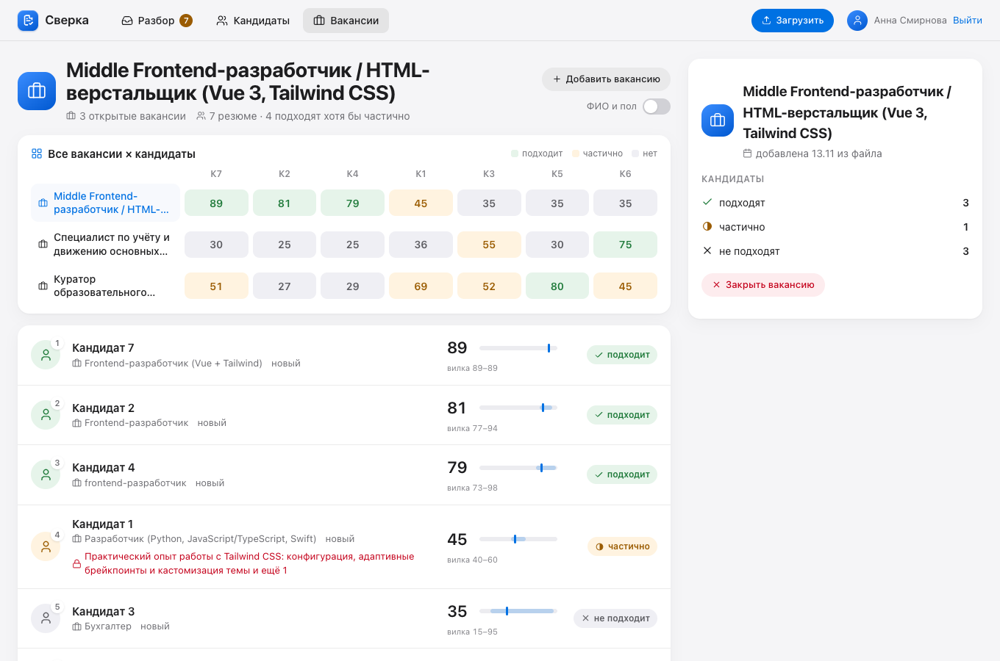
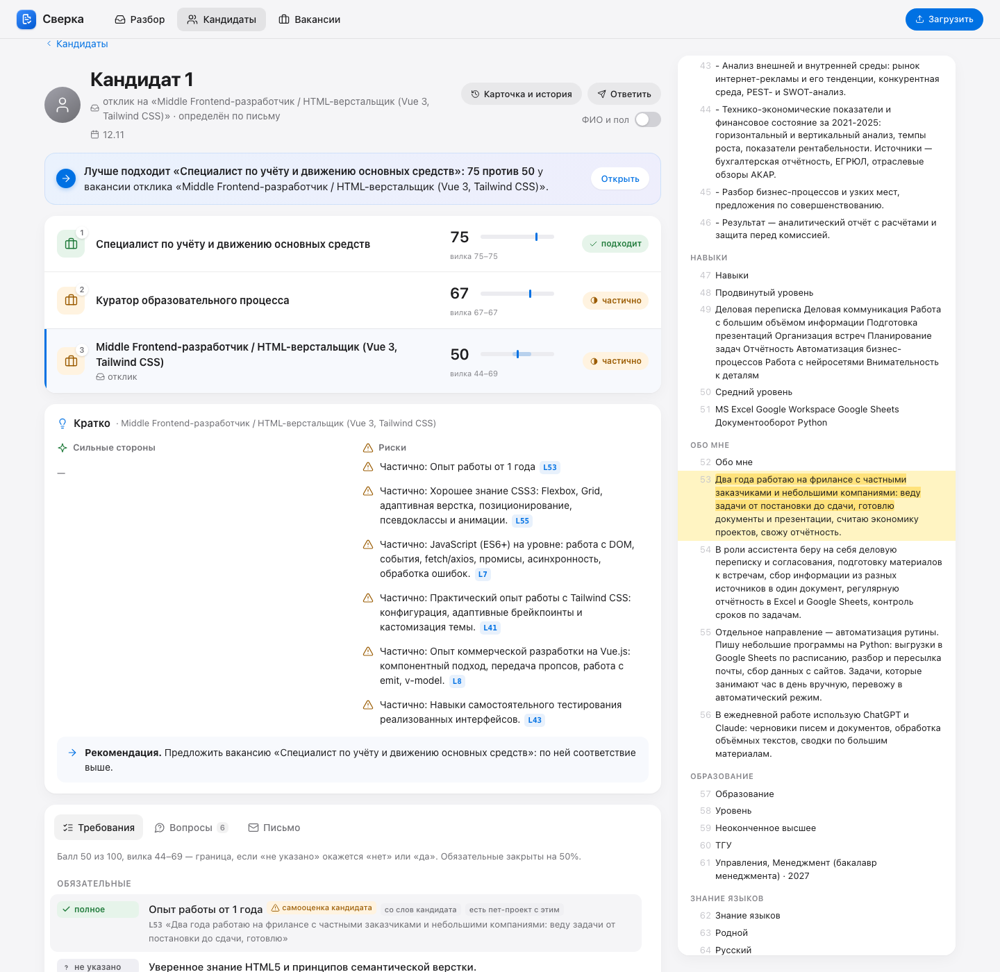
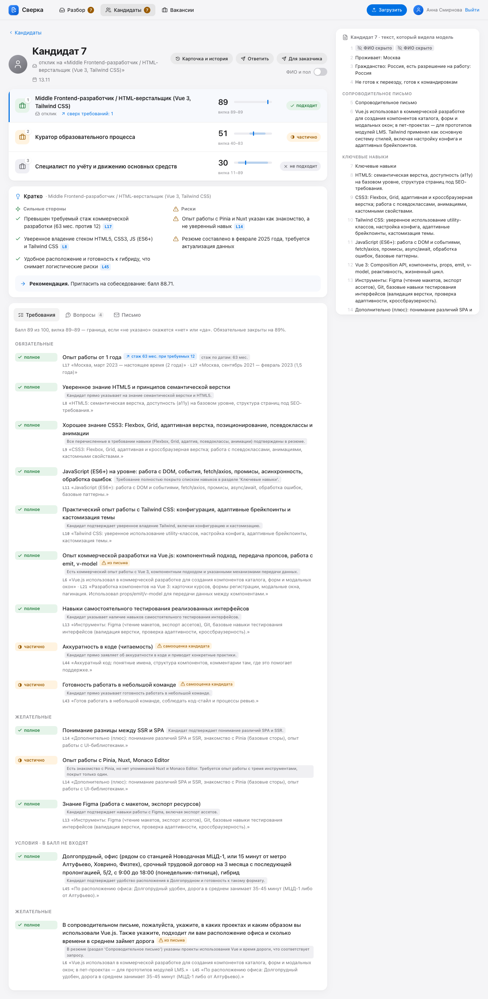
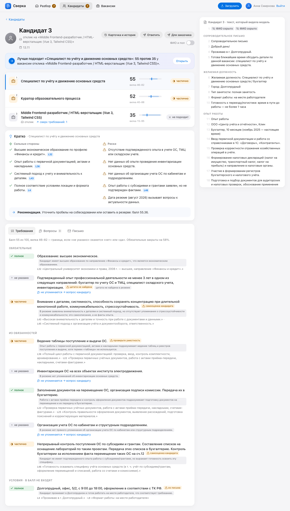
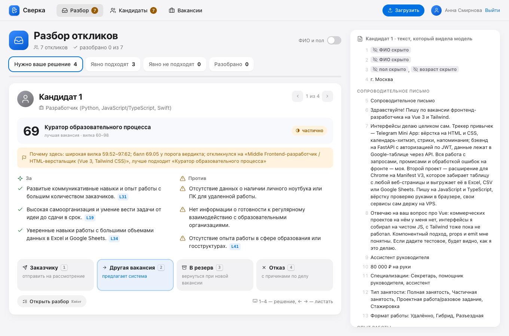
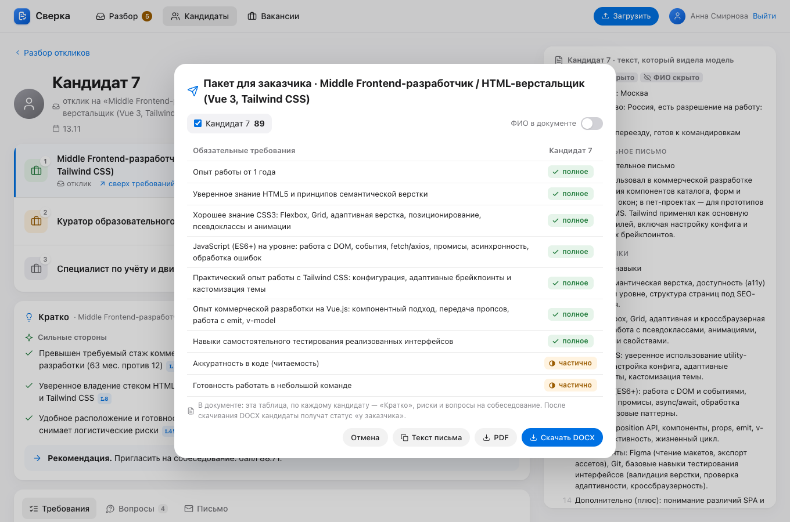
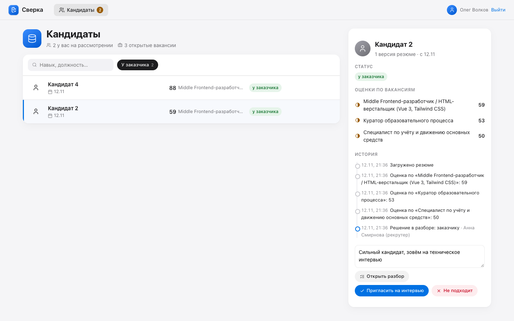
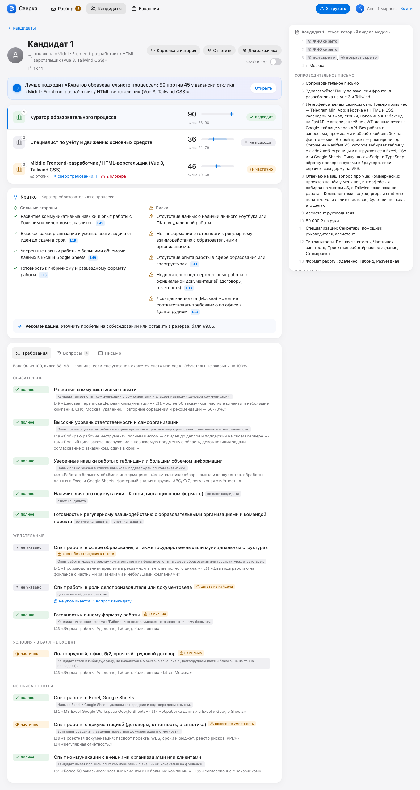

# Сценарии работы

Шесть сценариев на данных кейса: три вакансии организаторов и семь резюме — четыре резюме кейса
и три синтетических из `data/demo/`. Все цифры, статусы и цитаты ниже — ответы модели
`qwen/qwen3.6-35b-a3b`, записанные в `data/demo/cache.sqlite`; статусы, балл, вилку и рейтинг
посчитал код. Дата расчёта стажа — 12.11.2026 (`RVM_TODAY`).

Без ФИО: в документах и на снимках кандидаты подписаны номерами («Кандидат 7»), переключатель
«ФИО и пол» выключен. Соответствие номеров на снимках и файлов:

| На экране | Резюме | Профиль |
|---|---|---|
| Кандидат 1 | Резюме 1 кейса | разработчик Python / JS, фриланс-аналитика |
| Кандидат 2 | Резюме 2 кейса | frontend-разработчик |
| Кандидат 3 | Резюме 4 кейса | бухгалтер |
| Кандидат 4 | «Резюме А» (синтетическое) | frontend-разработчик |
| Кандидат 5 | «Резюме Б» (синтетическое) | координатор программ для школьников |
| Кандидат 6 | «Резюме В» (синтетическое) | бухгалтер по учёту ОС и ТМЦ |
| Кандидат 7 | Резюме 3 кейса | frontend-разработчик (Vue + Tailwind) |

Вакансии: «Middle Frontend-разработчик / HTML-верстальщик (Vue 3, Tailwind CSS)» (дальше —
Frontend), «Специалист по учёту и движению основных средств» (Учёт ОС), «Куратор
образовательного процесса» (Куратор). Все семь резюме загружены одной пачкой как отклики на
Frontend.

Как воспроизвести без ключа модели: `docker compose up -d`, вход «Рекрутер», загрузить файлы
резюме кейса из материалов организаторов (в репозиторий они не входят) — ответы модели по ним
возьмутся из кэша. Синтетические резюме загружаются сами при первом старте.

Матрица всех вакансий и кандидатов — раздел «Вакансии»:

---

## 1. Одно резюме → рейтинг трёх вакансий

**Кто и зачем.** Рекрутер получил отклик и хочет за минуту понять, на какую из открытых вакансий
кандидат подходит лучше и что уточнить.

**Вход.** Резюме 1 кейса, раздел «Загрузка» или `POST /api/uploads?applied=1`.

**Что выдаёт система.** Рейтинг вакансий по этому кандидату:

| Место | Вакансия | Балл | Вилка | Вердикт | Почему |
|---|---|---|---|---|---|
| 1 | Куратор | 69,05 | 59,52–97,62 | частично | обязательные закрыты на 70 %, блокеров нет |
| 2 | Учёт ОС | 35,71 | 21,43–78,57 | не подходит | нет опыта в учёте ОС, 6 строк «не указано» |
| 3 | Frontend (отклик) | 45,16 | 40,32–59,68 | частично | 2 блокера: Tailwind и коммерческий Vue — «нет» |

Frontend стоит ниже Учёта ОС при большем балле: вакансия с блокером (обязательное требование
«нет» с цитатой-противоречием) всегда ниже вакансий без блокеров.

Таблица требований по вакансии на первом месте (Куратор), сокращённо:

| Требование | Раздел | Цитата из резюме | Статус | Комментарий модели |
|---|---|---|---|---|
| Развитые коммуникативные навыки | обязательное | L31 «Более 50 заказчиков: частные клиенты и небольшие компании.» | есть | опыт коммуникации с 50+ клиентами |
| Ответственность и самоорганизация | обязательное | L36 «Полный цикл заказа: … согласование с заказчиком, сдача в срок.» | есть | полный цикл и сдача в срок |
| Таблицы и большой объём информации | обязательное | L49 «Работа с большим объёмом информации» | есть | навык подтверждён опытом аналитики |
| Личный ноутбук или ПК | обязательное | — | не указано | → вопрос кандидату |
| Взаимодействие с образовательными организациями | обязательное | — | не указано | опыт в рекламном агентстве, не в образовании |
| Опыт в образовании или госструктурах | желательное | — | не указано | цитата модели не про отказ — код снял «нет» |
| Опыт делопроизводителя или документоведа | желательное | — | не указано | цитата не найдена в резюме — код снял статус |
| Готовность к очному формату | желательное | L13 «Формат работы: Удалённо, Гибрид, Разъездная» | есть | из сопроводительного письма |
| Долгопрудный, офис, 5/2 | условие (в балл не входит) | L13 «Формат работы: Удалённо, Гибрид, Разъездная» | частично | кандидат в Москве |
| Опыт работы с Excel, Google Sheets | из обязанностей | L51 «MS Excel Google Workspace Google Sheets» | есть | |
| Документация: договоры, отчётность | из обязанностей | L33 «Проектная документация: паспорт проекта, WBS, …» | частично | помечено «проверьте уместность» |

- **Сильные стороны:** коммуникация с большим числом заказчиков (L49); самоорганизация, задачи от
  идеи до сдачи в срок (L19); Excel и Google Sheets (L49).
- **Риски:** нет данных о личном ноутбуке (R4); нет данных о работе с образовательными
  организациями (R5); нет опыта в образовании и госструктурах (L41); локация — Москва, офис в
  Долгопрудном (L13).
- **Вопросы кандидату** (по строкам «не указано», после юридического фильтра): «есть ли у вас
  личный ноутбук или ПК для работы в дистанционном формате?», «готовы ли вы к регулярному
  взаимодействию с образовательными организациями и командой проекта?», «расскажите об опыте
  работы в сфере образования, госструктурах», «были ли задачи в роли делопроизводителя или
  документоведа?».

**Чем помогает рекрутеру.** Вместо чтения резюме против трёх вакансий — готовый рейтинг, по каждой
строке вакансии цитата с номером строки (текст резюме, который видела модель, — справа), список того, что
не подтверждено, и вопросы на звонок. Цитаты, которых нет в резюме, код не пропускает: две строки
выше получили «не указано» с пометкой, а не выдуманный статус.

## 2. Переадресация: откликнулся на Frontend, лучше подходит Куратор

**Кто и зачем.** Рекрутер разбирает отклики на Frontend; часть откликнувшихся сильнее на другой
открытой вакансии, и их не хочется терять отказом.

**Вход.** То же резюме 1 кейса, отклик на Frontend.

**Что выдаёт система.** Над рейтингом — плашка «Лучше подходит «Куратор образовательного
процесса»: 69 против 45 у вакансии отклика», кнопка «Открыть» ведёт в разбор по Куратору. В
«Разборе откликов» кандидат попадает в корзину «Нужно ваше решение» с причинами: «широкая вилка
59.52–97.62», «балл 69.05 у порога вердикта», «откликнулся на Frontend, лучше подходит Куратор».

Правило кода (`scoring/rank.py`): переадресация, если у лучшей вакансии нет блокеров и вердикт не
хуже «частично», а у вакансии отклика есть блокер или разрыв ≥ 10 баллов. Здесь сработали оба
условия: блокеры Tailwind и Vue (L8 «с Tailwind тоже пока не работал», «коммерческих проектов на
нём у меня нет») и разрыв 23,9 балла.

На тех же данных переадресацию получили ещё три отклика на Frontend: Кандидат 3 и Кандидат 6 →
Учёт ОС, Кандидат 5 → Куратор. По эталонной разметке кейса переадресация верна в 4 из 4 резюме
(`eval/report.md`).

**Чем помогает рекрутеру.** Кандидат не уходит в отказ по чужой вакансии; рекрутер видит, куда его
предложить, с разницей баллов и строками, которые её дали, и одной клавишей (2 — «другая
вакансия») переносит его.

## 3. Сильный кандидат и частичный: чем отличается вывод

**Кто и зачем.** Рекрутер решает, кого звать сразу, а кого сначала уточнить.

**Вход.** Кандидат 7 (резюме 3 кейса) × Frontend и Кандидат 3 (резюме 4 кейса) × Учёт ОС.

| | Кандидат 7 × Frontend | Кандидат 3 × Учёт ОС |
|---|---|---|
| Балл | 88,71 | 55,36 |
| Вилка | 88,71–88,71 (ни одной строки «не указано») | 46,43–82,14 (3 строки «не указано» из 9) |
| Вердикт | подходит | частично |
| Обязательные закрыты | 88,89 % | 58,33 % |
| Строк с цитатой | 14 из 14 | 6 из 9 |
| Пометки | 2 строки «частично» — только самоописание («Аккуратный код…», «Готов работать в небольшой команде…») | главное требование «опыт от 3 лет в учёте ОС / ТМЦ» — цитата модели не нашлась в тексте, код поставил «не указано» |
| Риски | 2: Pinia и Nuxt — «знакомство»; резюме составлено в феврале 2025 | 5: нет подтверждённого опыта в учёте ОС, инвентаризации, учёте по кабинетам; субсидии и гранты — только готовность освоить; вопрос к дате резюме |
| Рекомендация | «Пригласить на собеседование: балл 88.71» | «Уточнить пробелы на собеседовании или оставить в резерве: балл 55.36» |
| Корзина «Разбора» | «Явно подходят» | «Нужно ваше решение» (широкая вилка) |

Ширина вилки — главный сигнал: у сильного кандидата балл не зависит от ответов на вопросы, у
частичного — от 46 до 82 в зависимости от того, что он ответит по строкам «не указано». Отдельная
проверка заметила, что резюме Кандидата 7 составлено в феврале 2025, и добавила вопрос об
актуальности.

**Чем помогает рекрутеру.** Сильного — сразу в пакет руководителю; частичного — звонок по
конкретным вопросам вместо отказа или слепого приглашения.

Кандидат 7 × Frontend:

Кандидат 3 × Учёт ОС:

## 4. Ни одна вакансия не подходит

**Не показано на данных кейса:** у каждого из семи резюме хотя бы одна вакансия с вердиктом
«подходит» или «частично». Ближе всего — Кандидат 2 (frontend): Учёт ОС 25,0 и Куратор 27,38 —
обе «не подходит», но Frontend у него 81,45. Новые резюме ради этого сценария не загружались:
каждое уходит в живую модель.

**Как система себя ведёт** (код `scoring/rank.py`, тест `tests/test_scoring.py::test_none_fit`):

- вердикт пары — по баллу: ≥ 70 «подходит», 45–70 «частично», < 45 «не подходит»;
- если у всех вакансий с данными вердикт «не подходит», отчёт получает `none_fit`, переадресации
  нет, над рейтингом — плашка «Ни одна открытая вакансия не подходит. Кандидата можно отправить в
  резерв — он будет сверен с новыми вакансиями»;
- рейтинг всё равно строится, у каждой вакансии видно, каких обязательных строк не хватило;
- в «Разборе» кандидат идёт в «Явно не подходят», но автоотказа нет: каждый десятый из этой
  корзины система выносит на выборочную проверку рекрутеру;
- решение 3 «резерв» — при добавлении новой вакансии резерв сверяется с ней, совпадения видны в
  разделе «Вакансии».

## 5. Пачка откликов → «Разбор» → пакет руководителю

**Кто и зачем.** Утром у рекрутера пачка откликов на одну вакансию; нужно отобрать кандидатов и
отдать нанимающему руководителю короткий сравнительный документ.

**Вход.** Семь резюме одной пачкой (несколько файлов или zip) как отклики на Frontend.

**Что выдаёт система.**

1. «Загрузка» показывает прогресс по каждому файлу: чтение → база → оценка.
2. «Разбор откликов» по Frontend раскладывает пачку:

   | Корзина | Кандидаты | Причина |
   |---|---|---|
   | Нужно ваше решение | 1, 3, 5, 6 | переадресация на другую вакансию; у Кандидата 1 и 3 — ещё широкая вилка, у 1 и 6 — балл у порога вердикта |
   | Явно подходят | 7 (88,71), 2 (81,45), 4 (79,03) | «подходит, блокеров нет» |
   | Явно не подходят | — | |

3. Решение клавишами: 1 — заказчику, 2 — другая вакансия, 3 — резерв, 4 — отказ. Кандидаты 7 и 2
   отправлены заказчику.
4. «Для заказчика» → пакет DOCX (или PDF через печать): сравнительная таблица обязательных
   требований по кандидатам («есть / частично / не указано», в конце балл с вилкой), по каждому —
   «Кратко», риски, рекомендация, вопросы на собеседование. ФИО в документе выключены — в пакете
   «Кандидат №7», «Кандидат №2». После скачивания статус кандидатов — «у заказчика».
5. Нанимающий руководитель входит своей учёткой и видит только кандидатов «у заказчика» (2), без
   ФИО, с тем же разбором и кнопками «Пригласить на интервью» / «Не подходит»; решение и комментарий пишутся в
   журнал кандидата.

Фрагмент таблицы пакета:

| Требование | Кандидат №7 | Кандидат №2 |
|---|---|---|
| Практический опыт работы с Tailwind CSS | есть | есть |
| Опыт коммерческой разработки на Vue.js | есть | есть |
| Навыки самостоятельного тестирования интерфейсов | есть | частично |
| Аккуратность в коде (читаемость) | частично | не указано |
| Готовность работать в небольшой команде | частично | есть |
| Балл (вилка) | 88.71 (88.71–88.71) | 81.45 (77.42–93.55) |

Повторная загрузка того же файла не создаёт нового кандидата. Если у нового резюме тот же телефон
или почта, что у существующей карточки (сравниваются HMAC-хэши, не сами контакты), карточка
получает пометку «возможный повтор»; объединяет карточки только рекрутер — «Объединить» или «Разные
люди».

**Чем помогает рекрутеру.** Внимание уходит только на корзину «Нужно ваше решение»; документ
руководителю собирается из готовых разборов, а не пишется вручную.

## 6. Ответы кандидата → пересчёт

**Кто и зачем.** Рекрутер созвонился с Кандидатом 1 по вопросам из сценария 1 и вносит ответы.

**Вход.** Во вкладке «Требования» по строкам «не указано» — ответ «есть» со слов кандидата
(`PATCH /api/evaluations/1/3/rows/R4`, затем `…/R5`). Модель не вызывается: пересчёт делает код.

**Что выдаёт система.**

| Шаг | Балл | Вилка | Обязательные | Вердикт |
|---|---|---|---|---|
| До ответов | 69,05 | 59,52–97,62 | 70 % | частично |
| R4 «личный ноутбук» = есть | 79,76 | 73,81–97,62 | 85 % | подходит |
| R5 «взаимодействие с образовательными организациями» = есть | 90,48 | 88,10–97,62 | 100 % | подходит |

Строки получают пометку «со слов кандидата», событие пишется в журнал, места вакансий и плашка
переадресации («90 против 45») пересчитываются.

Блок «Кратко» (сильные стороны, риски, рекомендация) после ответа пересобирается по правилам из
новой таблицы: закрытые строки уходят из рисков, рекомендация — с новым баллом и вердиктом.

**Ограничение:** после ответов «Кратко» собирается по правилам, без модели — формулировки суше,
чем при разборе.

**Чем помогает рекрутеру.** Ответы после звонка сразу меняют вердикт и рейтинг, видно, что строка
подтверждена со слов кандидата, а не резюме.

